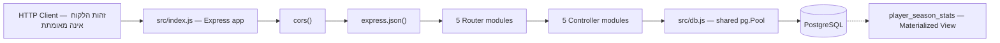
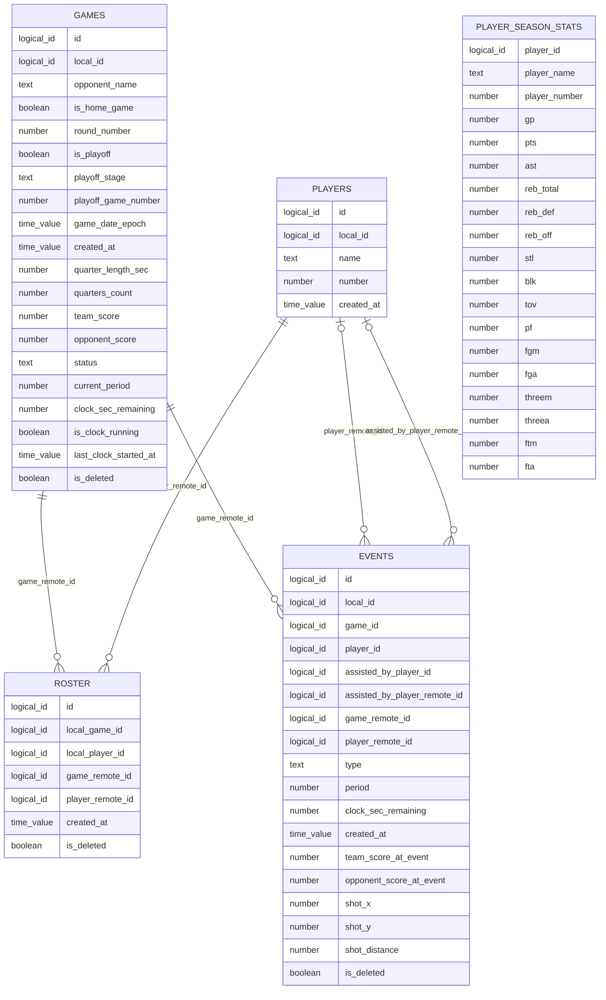
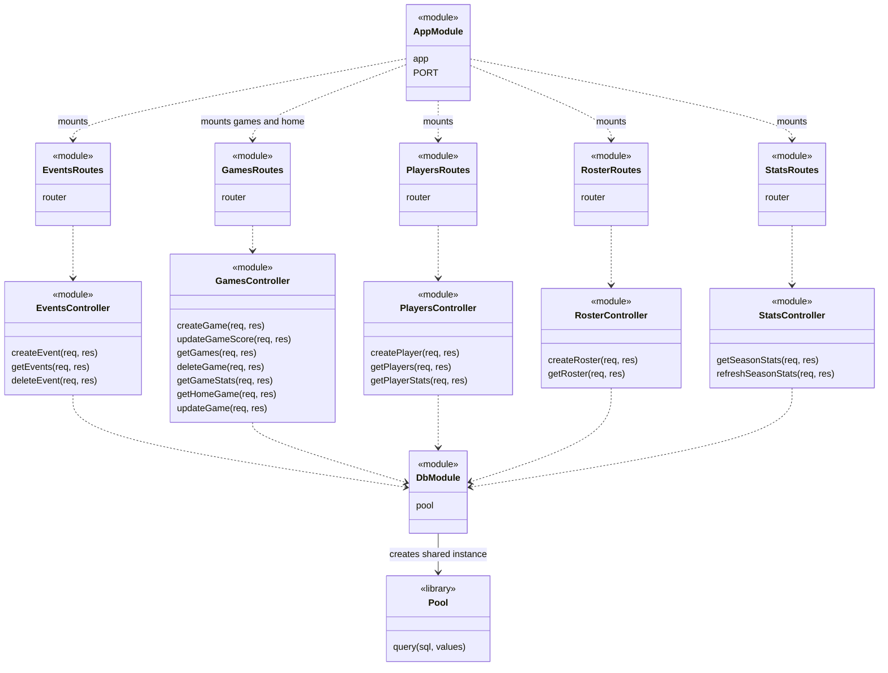
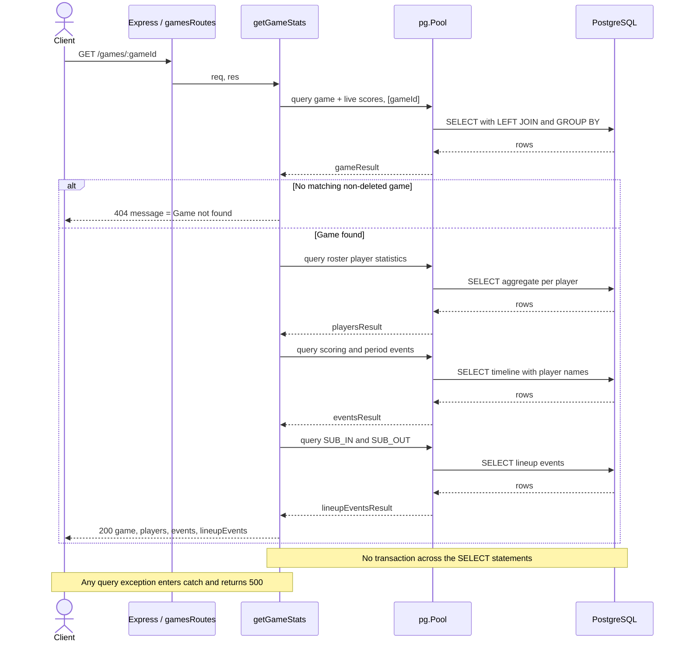
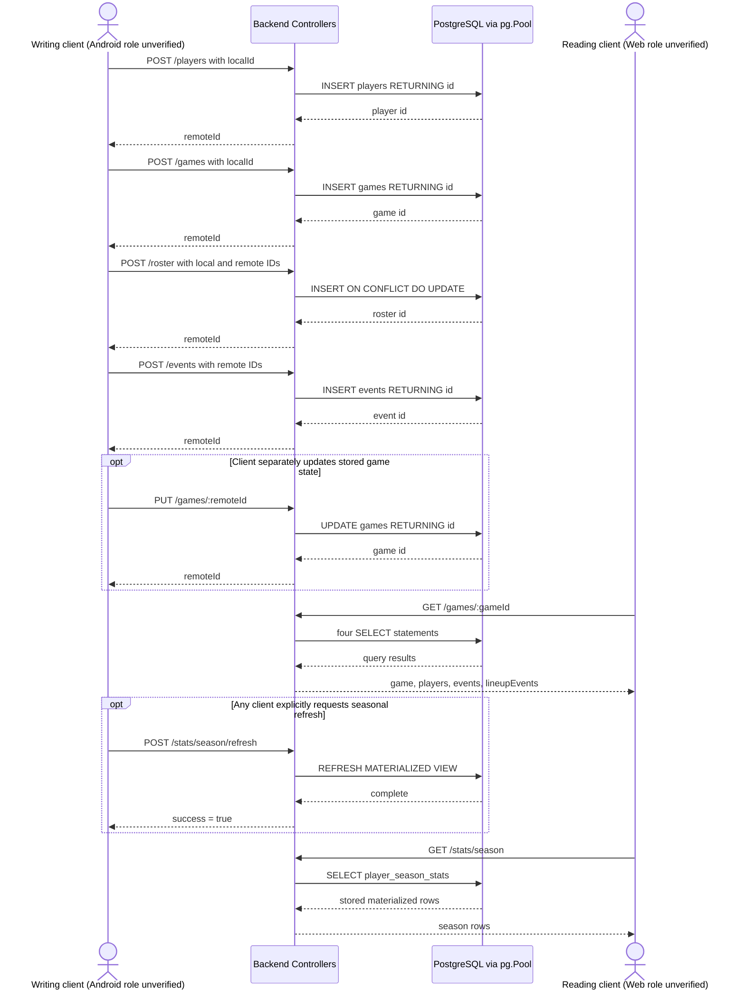
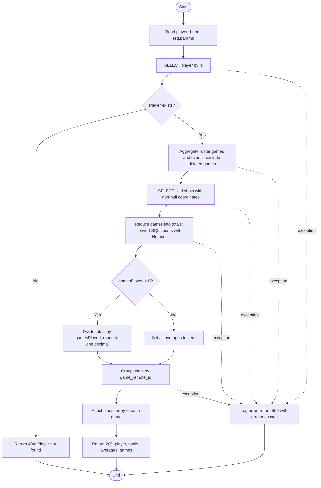
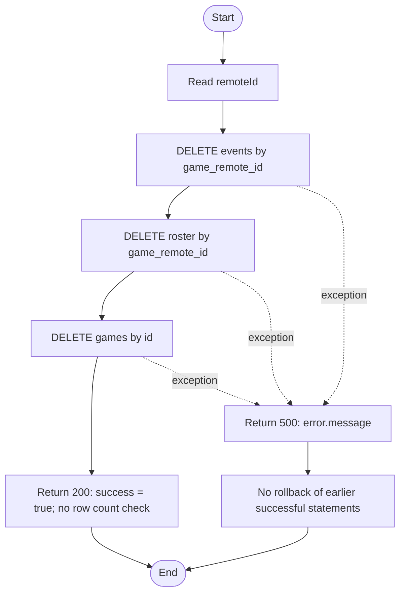

# Backend Design Context — Basketball Tracker

מסמך עזר ל־Detailed System Design, המבוסס על קוד המקור המקומי שנבדק ב־26.10.2026.

## 1. תחום הבדיקה ורמת הוודאות

נבדקו כל 12 קובצי היישום ב־`src/`, וכן `package.json`, `package-lock.json` ו־`.gitignore`. נבדק גם אילו קבצים מנוהלים ב־Git, ללא קריאת תוכן `.env`. לא שונה קוד היישום, לא הופעל שרת, ולא בוצעו חיבור למסד נתונים או פעולות API מול מערכת פעילה.

המסמך משתמש בשלוש רמות תיאור:

- **מימוש קיים**: התנהגות הנראית במפורש בקוד, בשאילתות או בהגדרות הפרויקט.
- **מסקנה הנדסית**: פירוש של מבנה הקוד או תוצאה אפשרית שלו; אינו מעיד על רכיב נוסף שמומש.
- **הצעה לשיפור**: שינוי עתידי שאינו חלק מהמימוש הנוכחי.

לא נמצאו בפרויקט קובצי DDL, Schema, Migrations, הגדרת ה־Materialized View, בדיקות יישום, OpenAPI, Docker או הגדרות Deployment. קוד Android וקוד Web אינם כלולים בתיקייה שנבדקה. לכן לא ניתן לאמת את מבנה המסד הפיזי, התנהגות הלקוחות, סביבת הייצור או תצורת התשתיות. קוד ספריות צד שלישי ב־`node_modules` אינו נחשב קוד היישום לעניין ניתוח זה.

## 2. ארכיטקטורת השרת וטכנולוגיות

### 2.1 המבנה הקיים

היישום הוא שרת Node.js אחד עם Express, בחלוקה ל־Routers ול־Controllers לפי תחום. כל Controller מייבא אותו `pool` מ־`src/db.js`, מפעיל SQL ישירות ומחזיר תשובת HTTP. אין שכבת Services, Repository, ORM, מחלקות Domain או מנוע Templates.



**מסקנה הנדסית:** זהו Monolith קטן בעל הפרדה חלקית לשכבות. שכבת HTTP מופרדת מבחינת מיפוי הנתיבים, אך ה־Controllers משלבים Transport, לוגיקה עסקית וגישה לנתונים. שיתוף ה־Pool הוא בתוך תהליך Node.js; אין בקוד תזמור של תהליכים מרובים.

### 2.2 ספריות ותצורה

| רכיב | גרסה ב־`package.json` | גרסה נעולה ב־`package-lock.json` | שימוש בפועל |
|---|---|---|---|
| Express | `^5.2.1` | `5.2.1` | App, Router, JSON parsing, HTTP responses |
| cors | `^2.8.6` | `2.8.6` | `app.use(cors())` ללא אפשרויות מותאמות |
| dotenv | `^17.4.2` | `17.4.2` | `dotenv.config()` ב־`index.js` וב־`db.js` |
| pg | `^8.20.0` | `8.20.0` | PostgreSQL driver ו־Connection Pool |
| nodemon | `^3.1.14` | `3.1.14` | תלות פיתוח; הפעלה מחדש בעת שינוי קבצים |

הפרויקט משתמש ב־JavaScript וב־ES Modules, באמצעות `"type": "module"`. אין TypeScript או שלב Build. אין `engines` ברמת הפרויקט; ה־lockfile מציין דרישת Node.js של `>=18` עבור Express. גרסת Node בשרת הייצור וגרסת PostgreSQL אינן מתועדות בקוד.

`npm run dev` מפעיל `nodemon src/index.js`. השדה `main` מצביע על `index.js` בשורש, אך קובץ כזה אינו נמצא; נקודת הכניסה בפועל של סקריפט הפיתוח היא `src/index.js`. אין סקריפט `start`. סקריפט `test` הוא Placeholder שמדפיס שגיאה ומסתיים בקוד 1.

שמות משתני הסביבה המשמשים את הקוד, ללא ערכים:

- `PORT`: הפורט; ברירת המחדל בקוד היא `3000`.
- `DATABASE_URL`: מועבר כ־`connectionString` ל־`pg.Pool`.

`src/db.js` יוצר `new Pool({ connectionString, ssl: { rejectUnauthorized: false } })`. אין בקוד הגדרות מפורשות לגודל ה־Pool, Timeouts, בדיקת מוכנות למסד, Retry או סגירה מסודרת באמצעות `pool.end()`. השרת מתחיל להאזין ללא שאילתת בדיקה מוקדמת. `GET /` אינו בודק PostgreSQL.

## 3. מבנה תיקיות ופירוק למודולים

```text
basketball-backend/
├── package.json
├── package-lock.json
├── .gitignore                 # ריק במצב שנבדק
├── .env                       # תוכנו לא נקרא
├── node_modules/              # ספריות מותקנות
└── src/
    ├── index.js               # Bootstrap, Middleware, mounting, listen
    ├── db.js                  # יצירת Pool משותף
    ├── routes/
    │   ├── events.js
    │   ├── games.js
    │   ├── players.js
    │   ├── roster.js
    │   └── stats.js
    └── controllers/
        ├── eventsController.js
        ├── gamesController.js
        ├── playersController.js
        ├── rosterController.js
        └── statsController.js
```

| מודול Controller | פונקציות מיוצאות | אחריות ותלויות נתונים |
|---|---|---|
| `src/controllers/eventsController.js` | `createEvent`, `getEvents`, `deleteEvent` | כתיבה, רשימה ומחיקה של `events` |
| `src/controllers/gamesController.js` | `createGame`, `updateGameScore`, `getGames`, `deleteGame`, `getGameStats`, `getHomeGame`, `updateGame` | משחקים; מחיקת נתונים תלויים; שילוב `games`, `events`, `roster`, `players` |
| `src/controllers/playersController.js` | `createPlayer`, `getPlayers`, `getPlayerStats` | שחקנים; אגרגציה של משחקים ואירועים דרך הסגל |
| `src/controllers/rosterController.js` | `createRoster`, `getRoster` | שיוך משחק–שחקן ו־Upsert |
| `src/controllers/statsController.js` | `getSeasonStats`, `refreshSeasonStats` | קריאה ורענון של `player_season_stats` |

יש 17 פונקציות Controller. כל קובץ Route מייצא מופע `express.Router()` ומחבר מתודות HTTP לפונקציות אלה. אין לוגיקה עסקית בקובצי Routes.

### Middleware וסדר הביצוע

ב־`src/index.js`: תחילה `cors()`, אחריו `express.json()`, אחריהם `GET /` ו־mounting של ה־Routers. אין Middleware ייעודי ל־Authentication, Authorization, Validation, Rate Limiting, Request ID, לוג HTTP או טיפול מרכזי בשגיאות. קיימים `console.log` ו־`console.error` בתוך פונקציות.

## 4. PostgreSQL — מודל הנתונים הנצפה בקוד

### 4.1 מגבלות שחזור הסכמה

**מימוש קיים:** השאילתות מתייחסות ל־`games`, `players`, `roster`, `events` ול־Materialized View בשם `player_season_stats`.

**מסקנה הנדסית:** ארבע הישויות הראשונות משמשות כטבלאות יישומיות, ו־`id` משמש כמזהה שרת. אין DDL שמוכיח `PRIMARY KEY`, מנגנון יצירת מזהים, טיפוסי SQL, `NOT NULL`, ערכי Default, `CHECK`, Indexes או Foreign Keys. לכן הסוגים להלן הם משמעות לוגית צפויה בלבד, ולא הגדרת SQL מאומתת. העמודות המפורטות הן כל העמודות שנצפו בקוד, ולא התחייבות שאין במסד עמודות נוספות.

### 4.2 `games`

מקור: `createGame`, `getGames`, `updateGame`, `getGameStats`, `getHomeGame` ב־`src/controllers/gamesController.js`.

| שדה DB | שדה Request ביצירה | משמעות לוגית והתנהגות |
|---|---|---|
| `id` | — | מזהה שרת; מוחזר ב־`RETURNING id`, ומשמש לחיפוש ולעדכון |
| `local_id` | `localId` | מזהה לקוח; `null` אם הערך חסר או `null`; אינו מתעדכן ב־PUT |
| `opponent_name` | `opponentName` | שם היריבה |
| `is_home_game` | `isHomeGame` | דגל משחק בית |
| `round_number` | `roundNumber` | מספר מחזור |
| `is_playoff` | `isPlayoff` | דגל Playoff |
| `playoff_stage` | `playoffStage` | שלב Playoff; אין Enum בקוד |
| `playoff_game_number` | `playoffGameNumber` | מספר משחק בשלב |
| `game_date_epoch` | `gameDateEpoch` | תאריך בערך Epoch לפי שם השדה; היחידה אינה מוגדרת בקוד |
| `created_at` | `createdAt` | ערך זמן מהלקוח; אין Default יישומי ביצירת משחק |
| `quarter_length_sec` | `quarterLengthSec` | אורך רבע בשניות |
| `quarters_count` | `quartersCount` | מספר רבעים |
| `team_score` | `teamScore` | תוצאה שמורה של הקבוצה |
| `opponent_score` | `opponentScore` | תוצאה שמורה של היריבה |
| `status` | `status` | ברירת מחדל יישומית `FINISHED`; `LIVE` משמש לבחירת משחק הבית |
| `current_period` | `currentPeriod` | תקופה/רבע נוכחי |
| `clock_sec_remaining` | `clockSecRemaining` | זמן שנותר בשניות |
| `is_clock_running` | `isClockRunning` | דגל שעון פועל |
| `last_clock_started_at` | `lastClockStartedAt` | זמן התחלת שעון שסופק מהלקוח; יחידת הזמן אינה נאכפת |
| `is_deleted` | — | משמש לסינון קריאות; אין בקוד כתיבה אליו |

### 4.3 `players`

מקור: `src/controllers/playersController.js`.

| שדה DB | שדה Request | משמעות לוגית |
|---|---|---|
| `id` | — | מזהה שרת של שחקן |
| `local_id` | `localId` | מזהה לקוח; ברירת מחדל יישומית `null` |
| `name` | `name` | שם שחקן |
| `number` | `number` | מספר גופייה; אין אימות או הוכחת ייחודיות |
| `created_at` | `createdAt` | זמן יצירה שסופק מהלקוח |

לא נצפה שימוש ב־`players.is_deleted`, ולא קיימים Endpoints לעדכון או למחיקת שחקן.

### 4.4 `roster`

מקור: `src/controllers/rosterController.js`; קריאות גם ב־`getGameStats` וב־`getPlayerStats`.

| שדה DB | שדה Request | משמעות לוגית |
|---|---|---|
| `id` | — | מזהה שרת של רשומת סגל |
| `local_game_id` | `gameId` | מזהה משחק מקומי |
| `local_player_id` | `playerId` | מזהה שחקן מקומי |
| `game_remote_id` | `gameRemoteId` | קישור לוגי אל `games.id` |
| `player_remote_id` | `playerRemoteId` | קישור לוגי אל `players.id` |
| `created_at` | `createdAt` | אם חסר או `null`, נעשה שימוש ב־`Date.now()` — milliseconds |
| `is_deleted` | — | מסונן ב־`getRoster`; אינו נכתב בקוד |

`createRoster` משתמש ב־`ON CONFLICT (local_game_id, local_player_id) DO UPDATE`. זו דרישה מפורשת של השאילתה למנגנון ייחודיות מתאים במסד על הזוג המקומי; ההגדרה עצמה אינה בקוד. בהתנגשות מתעדכנים רק `game_remote_id`, `player_remote_id`, `created_at`. אין איפוס `is_deleted`.

אין בקוד הוכחה לייחודיות הזוג `(game_remote_id, player_remote_id)`. אם כמה רשומות סגל מקשרות אותו זוג מרוחק, ה־JOIN עלול להכפיל אירועים בחישוב סטטיסטיקות.

### 4.5 `events`

מקור: `src/controllers/eventsController.js`; אגרגציות ב־Controllers של משחקים ושחקנים.

| שדה DB | שדה Request | משמעות לוגית |
|---|---|---|
| `id` | — | מזהה אירוע בשרת |
| `local_id` | `localId` | מזהה אירוע מקומי; ברירת מחדל `null` |
| `game_id` | `gameId` | מזהה משחק מקומי; מוחזר ברשימה כ־`local_game_id` |
| `player_id` | `playerId` | מזהה שחקן מקומי; מוחזר ברשימה כ־`local_player_id` |
| `assisted_by_player_id` | `assistedByPlayerId` | מזהה מקומי של השחקן המוסר |
| `assisted_by_player_remote_id` | `assistedByPlayerRemoteId` | קישור לוגי ל־`players.id` של המוסר |
| `game_remote_id` | `gameRemoteId` | קישור לוגי ל־`games.id` |
| `player_remote_id` | `playerRemoteId` | קישור לוגי ל־`players.id` של מבצע האירוע |
| `type` | `type` | סוג אירוע טקסטואלי; אין בדיקת Enum ביצירה |
| `period` | `period` | תקופת משחק |
| `clock_sec_remaining` | `clockSecRemaining` | שעון בעת האירוע, בשניות |
| `created_at` | `createdAt` | זמן יצירה שסופק מהלקוח |
| `team_score_at_event` | `teamScoreAtEvent` | Snapshot תוצאת קבוצה בעת האירוע |
| `opponent_score_at_event` | `opponentScoreAtEvent` | Snapshot תוצאת יריבה בעת האירוע |
| `shot_x` | `shotX` | קואורדינטת זריקה; טווח, יחידה וכיוון אינם מוגדרים |
| `shot_y` | `shotY` | קואורדינטת זריקה; טווח, יחידה וכיוון אינם מוגדרים |
| `shot_distance` | `shotDistance` | מרחק זריקה מסופק; אין חישוב מרחק בשרת |
| `is_deleted` | — | מסונן ב־`getEvents`; אינו נכתב בקוד |

השדות המקומיים `game_id` ו־`player_id` אינם משמשים לחיבור לטבלאות `games` ו־`players` בשאילתות הסטטיסטיקה. החיבור מתבצע באמצעות השדות המרוחקים.

### 4.6 `player_season_stats`

`src/controllers/statsController.js` מוכיח שימוש ב־Materialized View: הפונקציה `refreshSeasonStats` מבצעת `REFRESH MATERIALIZED VIEW player_season_stats`.

כל העמודות הנקראות: `player_id`, `player_name`, `player_number`, `gp`, `pts`, `ast`, `reb_total`, `reb_def`, `reb_off`, `stl`, `blk`, `tov`, `pf`, `fgm`, `fga`, `threem`, `threea`, `ftm`, `fta`.

שמות כמו `gp`, `pts`, `fgm`, `fga` מרמזים על Games Played, Points ונתוני קליעה, אך הגדרת ה־View אינה זמינה. לא ניתן לאמת אם הערכים הם סכומים או ממוצעים, כיצד נספרים משחקים, כיצד מוגדרת עונה, אילו סטטוסים נכללים, מהי משמעות `fgm` ביחס לשלשות, או כיצד מטופלות רשומות מחוקות. ה־API רק קורא את העמודות וממיין לפי `pts DESC`.

לא נצפתה טבלת `seasons`, טבלת קבוצות או טבלת משתמשים בקוד היישום. אין להסיק מכך שהן בהכרח אינן קיימות במסד שמחוץ לפרויקט.

### 4.7 קשרים, מפתחות ו־ERD

ה־ERD הוא **מודל לוגי מוסק מה־JOINs**, ולא Schema פיזי מאומת. הסימון `logical_id` אינו טיפוס PostgreSQL. לא מוצגים סימוני PK/FK מחייבים כי לא נמצאה הגדרתם. האופציונליות היא תיאור לוגי בלבד; `NULL` ו־Referential Integrity אינם מאומתים.



`roster` מממש קשר לוגי Many-to-Many בין משחקים לשחקנים. שני הקשרים מ־`players` ל־`events` מייצגים תפקידים שונים: מבצע ומוסר. לא צויר קשר מקור ל־`PLAYER_SEASON_STATS`, משום שהגדרת שאילתת ה־View אינה זמינה.

**מסקנה הנדסית:** נשמרים נתונים נגזרים לצד אירועי המקור: `games.team_score`, `games.opponent_score`, Snapshots של תוצאות באירועים ו־Materialized View. הדבר מאפשר קריאה נוחה אך יוצר כמה ייצוגים שדורשים עקביות. אין מנגנון עקביות כולל בקוד שנבדק.

## 5. מפרט REST API מלא

### 5.1 מוסכמות משותפות

- אין Prefix של גרסת API ואין דרישת Token או Session בקוד.
- בקשות כתיבה משתמשות ב־JSON עם מפתחות `camelCase`. רוב רשומות הקריאה מוחזרות ישירות מ־SQL במפתחות `snake_case`; מעטפות כגון `remoteId`, `lineupEvents`, `gamesPlayed` הן `camelCase`.
- לכל הצלחה היישום מחזיר `200`; אין שימוש מפורש ב־`201` או `204`.
- כל השדות בטבלאות Request לעיל הם שדות **שהקוד קורא**. אין Schema שמצהיר אילו מהם חובה. פרט לברירות המחדל המפורשות, השדות מועברים ל־`pg` ללא Validation; הצלחת בקשה חסרה תלויה גם באילוצי המסד שאינם זמינים.
- מזהים ב־Path מתקבלים מ־`req.params` ומועברים כפרמטרים ל־SQL ללא המרה או בדיקת טווח. טיפוס מזהה שגוי עשוי להסתיים ב־500, בהתאם לסכמה, ולא ב־400 מובנה.
- אין שימוש ב־`req.query`: אין Pagination, סינון לפי Query Parameters או חיפוש. רשימות עשויות להחזיר את כל הרשומות המתאימות.
- אין Normalization כללי של טיפוסי תגובה. ערכי `id`, Epoch ותוצאות SQL מוחזרים כפי שסיפק `pg`. ללא DDL והגדרות טיפוסים אין להתחייב שהם JSON numbers; גם אגרגציות SQL עשויות לחזור כמחרוזות. ב־`getPlayerStats` רק `totals` ו־`averages` מומרים/מחושבים במפורש כמספרי JavaScript.
- להלן `remoteId` בתגובה הוא תמיד `result.rows[0].id`; רשימה ריקה מוחזרת כ־`[]`.

### 5.2 מפת הנתיבים הראשית

| Method | Path | Handler | Request | תשובת הצלחה |
|---|---|---|---|---|
| GET | `/` | callback ב־`src/index.js` | ללא Body | הטקסט `Basketball backend is running` |
| POST | `/events` | `createEvent` | כל שדות Request בטבלת `events` | `{ "remoteId": id }` |
| GET | `/events` | `getEvents` | ללא Body | מערך EventListRow, מפורט בהמשך |
| DELETE | `/events/:remoteId` | `deleteEvent` | מזהה שרת ב־Path | `{ "success": true }` |
| POST | `/games` | `createGame` | כל שדות Request בטבלת `games` | `{ "remoteId": id }` |
| PATCH | `/games/score` | `updateGameScore` | `{ remoteId, teamScore, opponentScore }` | `{ "success": true }` |
| GET | `/games/home` | `getHomeGame` | ללא Body | `{ type, game }` |
| GET | `/games` | `getGames` | ללא Body | מערך GameListRow |
| GET | `/games/:gameId` | `getGameStats` | מזהה שרת ב־Path | `{ game, players, events, lineupEvents }` |
| PUT | `/games/:remoteId` | `updateGame` | שדות משחק כמתואר בהמשך | `{ "remoteId": id }` |
| DELETE | `/games/:remoteId` | `deleteGame` | מזהה שרת ב־Path | `{ "success": true }` |
| POST | `/players` | `createPlayer` | `{ localId, name, number, createdAt }` | `{ "remoteId": id }` |
| GET | `/players` | `getPlayers` | ללא Body | מערך PlayerListRow |
| GET | `/players/:playerId` | `getPlayerStats` | מזהה שרת ב־Path | `{ player, totals, averages, games }` |
| POST | `/roster` | `createRoster` | `{ gameId, playerId, gameRemoteId, playerRemoteId, createdAt }` | `{ "remoteId": id }` |
| GET | `/roster` | `getRoster` | ללא Body | מערך RosterListRow |
| GET | `/stats/season` | `getSeasonStats` | ללא Body | מערך SeasonStatsRow |
| POST | `/stats/season/refresh` | `refreshSeasonStats` | אין שדות Body בשימוש | `{ "success": true }` |

### 5.3 כל ה־Aliases תחת `/home`

`src/index.js` מחבר את **כל** `gamesRoutes` גם ל־`/home`. לכן קיימים עוד שבעה צירופי Method/Path, עם אותם Requests, Responses ושגיאות:

| Alias קיים | הנתיב המקביל |
|---|---|
| `POST /home` | `POST /games` |
| `PATCH /home/score` | `PATCH /games/score` |
| `GET /home/home` | `GET /games/home` |
| `GET /home` | `GET /games` |
| `GET /home/:gameId` | `GET /games/:gameId` |
| `PUT /home/:remoteId` | `PUT /games/:remoteId` |
| `DELETE /home/:remoteId` | `DELETE /games/:remoteId` |

בסך הכול 25 צירופי Method/Path רשומים במפורש לאחר הרחבת ה־mounts. המספר אינו כולל התנהגות אוטומטית של Framework כגון Preflight. בפרט, `GET /home` מחזיר רשימת משחקים; הוא אינו מפעיל `getHomeGame`. הנתיב הקבוע `GET /games/home` רשום לפני `GET /games/:gameId`, ולכן אינו מתפרש כמזהה משחק.

### 5.4 יצירה, עדכון ומחיקה — התנהגות מפורטת

**`POST /players` — `createPlayer`:** מבצע INSERT יחיד. `localId ?? null` הוא Default היחיד. אין חיפוש שחקן קיים, Upsert או מניעת Retry כפול ברמת היישום.

**`POST /games` — `createGame`:** מבצע INSERT עם 18 שדות Request המפורטים בטבלת `games`. `localId ?? null` ו־`status ?? "FINISHED"` הם Defaults יישומיים. שדות `id` ו־`is_deleted` אינם נשלחים ב־INSERT. אין יצירת סגל או אירועים כחלק מהבקשה.

**`PUT /games/:remoteId` — `updateGame`:** קורא את כל שדות יצירת משחק מלבד `localId`, ומעדכן את 17 העמודות המקבילות, כולל `created_at`. זה אינו Partial Update: לכל עמודה מוקצה פרמטר גם כאשר השדה לא סופק. אין שמירת ערך ישן באמצעות `COALESCE`. `status` חסר או `null` מוחלף ב־`FINISHED`. אין שינוי של `local_id` או `is_deleted`. נבדק `RETURNING id`; אם לא עודכנה רשומה מוחזר 404. כל `req.body` נרשם ל־Console.

**`PATCH /games/score` — `updateGameScore`:** מעדכן רק `team_score` ו־`opponent_score` לפי `remoteId` מתוך ה־Body. אין שינוי אירועים או בדיקת התאמה ביניהם לתוצאה. אין בדיקת `rowCount`; מזהה תקין תחבירית שאינו קיים עדיין עשוי לקבל `{ "success": true }`.

**`DELETE /games/:remoteId` — `deleteGame`:** מפעיל בסדר זה `DELETE FROM events WHERE game_remote_id = $1`, אחריו `DELETE FROM roster WHERE game_remote_id = $1`, ולבסוף `DELETE FROM games WHERE id = $1`. זו Hard Delete. אין Transaction, Rollback או בדיקת קיום; כשל מאוחר עשוי להשאיר מחיקה חלקית. ה־View העונתי אינו מרוענן.

**`POST /events` — `createEvent`:** INSERT יחיד עם 16 שדות Request מטבלת `events`. `localId ?? null` הוא Default היחיד. אין אימות סוג אירוע, שעון, שחקן בסגל או התאמת מזהים מקומיים ומרוחקים ברמת היישום. אין עדכון אוטומטי של תוצאת המשחק או יצירת אירוע `AST` בעקבות שדה המוסר.

**`DELETE /events/:remoteId` — `deleteEvent`:** Hard Delete יחיד לפי `id`, ללא בדיקת קיום. מוחזר Success גם אם לא נמחקה שורה. אין תיקון תוצאה שמורה, Snapshots של אירועים אחרים או רענון סטטיסטיקה עונתית.

**`POST /roster` — `createRoster`:** Upsert לפי הזוג המקומי. השדות המקומיים אינם משתנים בענף Update; המזהים המרוחקים ו־`created_at` נדרסים. `createdAt ?? Date.now()` חל גם בבקשה חוזרת. לכן בקשה חוזרת ללא זמן מפורש אינה Idempotent לחלוטין מבחינת Timestamp.

**`POST /stats/season/refresh` — `refreshSeasonStats`:** מפעיל `REFRESH MATERIALIZED VIEW player_season_stats` וממתין להשלמת השאילתה. אין `CONCURRENTLY`, Queue, Background Job או הרשאה מיוחדת בקוד. אין Trigger יישומי שקורא לפונקציה בעקבות כתיבה אחרת.

### 5.5 חוזי תשובה של רשימות

השמות הבאים הם כינויים תיעודיים בלבד; אין בקוד מחלקות או Types עם שמות אלה.

| טיפוס תיעודי | שדות מדויקים בתשובה | סינון ומיון |
|---|---|---|
| `PlayerListRow` | `id`, `local_id`, `name`, `number`, `created_at` | ללא סינון; `id ASC` |
| `RosterListRow` | `id`, `local_game_id`, `local_player_id`, `game_remote_id`, `player_remote_id`, `created_at` | `r.is_deleted = false`; `created_at ASC` |
| `EventListRow` | `id`, `local_id`, `local_game_id`, `local_player_id`, `assisted_by_player_id`, `assisted_by_player_remote_id`, `game_remote_id`, `player_remote_id`, `type`, `period`, `clock_sec_remaining`, `created_at`, `team_score_at_event`, `opponent_score_at_event`, `shot_x`, `shot_y`, `shot_distance` | `e.is_deleted = false`; `created_at ASC` |
| `GameListRow` | `id`, `local_id`, `opponent_name`, `is_home_game`, `round_number`, `is_playoff`, `playoff_stage`, `playoff_game_number`, `game_date_epoch`, `created_at`, `quarter_length_sec`, `quarters_count`, `team_score`, `opponent_score`, `status`, `current_period`, `clock_sec_remaining`, `is_clock_running`, `last_clock_started_at` | `is_deleted = false`; `created_at ASC` |
| `SeasonStatsRow` | `player_id`, `player_name`, `player_number`, `gp`, `pts`, `ast`, `reb_total`, `reb_def`, `reb_off`, `stl`, `blk`, `tov`, `pf`, `fgm`, `fga`, `threem`, `threea`, `ftm`, `fta` | ללא סינון יישומי; `pts DESC` |

`GET /events` ו־`GET /roster` אינם בודקים אם המשחק ההורה מסומן כמחוק. `is_deleted` עצמו אינו נכלל בתשובות הרשימה. אם ערכו במסד `NULL`, התנאי `= false` אינו כולל את הרשומה.

### 5.6 `GET /games/:gameId` — מבנה מפורט

מקור: `getGameStats`, `src/controllers/gamesController.js`. מבוצעות ארבע שאילתות סדרתיות בהצלחה, או שאילתה אחת כאשר המשחק אינו נמצא.

```text
{
  game: GameStatsHeader,
  players: PlayerGameStatsRow[],
  events: TimelineEventRow[],
  lineupEvents: LineupEventRow[]
}
```

- `GameStatsHeader`: כל שדות `GameListRow` מלבד `created_at`, ובנוסף `live_team_score`, `live_opponent_score`. המשחק חייב לעמוד ב־`g.is_deleted = false`.
- `PlayerGameStatsRow`: `player_id`, `player_name`, `player_number`, `points`, `rebounds`, `assists`, `steals`, `blocks`, `turnovers`, `fouls`, `two_made`, `two_miss`, `three_made`, `three_miss`, `ft_made`, `ft_miss`. הרשימה מבוססת סגל וממוינת לפי `p.number ASC`; גם שחקן בסגל ללא אירועים יכול להופיע עם אפסים.
- `TimelineEventRow`: `id`, `type`, `period`, `assisted_by_player_remote_id`, `clock_sec_remaining`, `team_score_at_event`, `opponent_score_at_event`, `created_at`, `player_name`, `player_number`, `assist_player_name`, `assist_player_number`. שמות השחקנים מחוברים ב־LEFT JOIN ולכן עשויים להיות `null`.
- `LineupEventRow`: `id`, `type`, `period`, `clock_sec_remaining`, `created_at`, `player_id`, `player_name`, `player_number`. כאן החיבור לשחקן הוא INNER JOIN; אירוע ללא שחקן תואם לא יופיע.

`events` כולל רק `TWO_MADE`, `THREE_MADE`, `FT_MADE`, `OPP_TWO_MADE`, `OPP_THREE_MADE`, `OPP_FT_MADE`, `PERIOD_END`, `PERIOD_START`. אין בו זריקות שהוחטאו, עבירות או את כל נתוני האירוע. `lineupEvents` כולל רק `SUB_IN`, `SUB_OUT`. שתי הרשימות ממוינות לפי `period ASC, clock_sec_remaining DESC, created_at ASC`; אין Tie-breaker נוסף של `id`.

אין סינון `e.is_deleted` באף אחת משאילתות המשחק ואין סינון `r.is_deleted` בחישוב נתוני השחקנים. `players` אינו כולל שחקנים שאינם בסגל גם אם קיימים עבורם אירועים, בעוד `live_team_score` מסכם אירועים של המשחק ללא תלות בסגל.

### 5.7 `GET /games/home` — בחירת משחק להצגה

מקור: `getHomeGame`, `src/controllers/gamesController.js`.

```text
{
  type: "LIVE" | "LAST_GAME",
  game: HomeGameRow | null
}
```

`HomeGameRow` כולל בדיוק: `id`, `opponent_name`, `is_home_game`, `round_number`, `is_playoff`, `playoff_stage`, `playoff_game_number`, `game_date_epoch`, `team_score`, `opponent_score`, `status`, `current_period`, `clock_sec_remaining`, `is_clock_running`, `last_clock_started_at`, `live_team_score`, `live_opponent_score`.

הבחירה היא מתוך משחקים עם `g.is_deleted = false`, במיון `CASE WHEN g.status = 'LIVE' THEN 0 ELSE 1 END` ואז `g.game_date_epoch DESC`, עם `LIMIT 1`. משחק `LIVE` מקבל עדיפות; בתוך קבוצת העדיפות נבחר התאריך הגדול ביותר. כאשר אין משחקים מוחזר `200` עם `{ "type": "LAST_GAME", "game": null }`.

המילה `LAST_GAME` אינה מבטיחה שהמשחק הסתיים: אין תנאי `status = 'FINISHED'` או תאריך לפני הזמן הנוכחי. אין חישוב שעון רץ בשרת. ניקוד ה־Live מחושב מהאירועים ללא סינון `e.is_deleted`.

**תלות בסכמה שאינה מאומתת:** השאילתה בוחרת גם שדות Playoff שאינם מופיעים ב־`GROUP BY`. הכללת `g.id` עשויה להספיק כאשר PostgreSQL מזהה תלות פונקציונלית מתאימה, למשל PK. ללא DDL לא ניתן לאשר שהשאילתה תקפה בכל סכמה; אין לקבוע שזהו Bug ודאי.

### 5.8 `GET /players/:playerId` — פרופיל סטטיסטי

מקור: `getPlayerStats`, `src/controllers/playersController.js`. מבוצעות שלוש שאילתות סדרתיות בהצלחה: שחקן, סטטיסטיקות משחקים, וזריקות עם קואורדינטות. אם השחקן אינו נמצא, מוחזר 404 לאחר השאילתה הראשונה.

```text
{
  player: { id, local_id, name, number },
  totals: { gamesPlayed, points, rebounds, assists, steals, blocks, turnovers },
  averages: { ppg, rpg, apg, spg, bpg, tpg },
  games: PlayerHistoryGameRow[]
}
```

`PlayerHistoryGameRow` כולל בדיוק: `game_id`, `opponent_name`, `round_number`, `game_date_epoch`, `team_score`, `opponent_score`, `points`, `rebounds`, `defensive_rebounds`, `offensive_rebounds`, `assists`, `steals`, `blocks`, `turnovers`, `two_made`, `two_miss`, `three_made`, `three_miss`, `ft_made`, `ft_miss`, `shots`.

כל פריט `shots` הוא `{ game_remote_id, type, shot_x, shot_y }`. נכללים רק ארבעת סוגי זריקות השדה: `TWO_MADE`, `TWO_MISS`, `THREE_MADE`, `THREE_MISS`, ורק אם שתי הקואורדינטות אינן `NULL`. אין `shot_distance`, זריקות עונשין או סדר מובטח ב־`shots`.

היסטוריית המשחקים מבוססת `roster`, כוללת רק משחקים עם `g.is_deleted = false`, וממוינת לפי `g.game_date_epoch DESC`. אין סינון לפי סטטוס המשחק, עונה או מחיקת סגל/אירוע. שאילתת הזריקות קוראת את כל הזריקות המתאימות של השחקן ללא סינון משחקים מחוקים; רק זריקות של משחקים שנמצאים במערך `games` מצורפות לתשובה. שחקן קיים ללא משחקים מקבל `games: []`, וכל המונים והממוצעים הם אפס. אין שדה Fouls בהיסטוריה או ב־totals של פרופיל זה.

### 5.9 טיפול בשגיאות — חוזים מדויקים

כל ה־Controllers עוטפים את העבודה ב־`try/catch` ומדפיסים שגיאה ל־Console. הערכים `<error.message>` להלן הם טקסט דינמי מחריגה, לא ערך מילולי.

| Handler | HTTP status | JSON Error Response |
|---|---|---|
| `createEvent` | 500 | `{ "error": "Failed to create event" }` |
| `getEvents` | 500 | `{ "error": "Failed to fetch events" }` |
| `deleteEvent` | 500 | `{ "error": "Failed to delete event" }` |
| `createGame` | 500 | `{ "error": "Failed to create game" }` |
| `updateGameScore` | 500 | `{ "error": "Failed to update game score" }` |
| `getGames` | 500 | `{ "error": "Failed to fetch games" }` |
| `deleteGame` | 500 | `{ "error": <error.message> }` |
| `getGameStats` | 404 | `{ "message": "Game not found" }` |
| `getGameStats` | 500 | `{ "message": "Failed to fetch game stats" }` |
| `getHomeGame` | 500 | `{ "message": "Failed to fetch home game", "error": <error.message> }` |
| `updateGame` | 404 | `{ "error": "Game not found" }` |
| `updateGame` | 500 | `{ "error": "Failed to update game" }` |
| `createPlayer` | 500 | `{ "error": "Failed to create player" }` |
| `getPlayers` | 500 | `{ "error": "Failed to fetch players" }` |
| `getPlayerStats` | 404 | `{ "message": "Player not found" }` |
| `getPlayerStats` | 500 | `{ "message": "Failed to fetch player stats", "error": <error.message> }` |
| `createRoster` | 500 | `{ "error": "Failed to create roster" }` |
| `getRoster` | 500 | `{ "error": "Failed to fetch roster" }` |
| `getSeasonStats` | 500 | `{ "error": "Failed to fetch season stats" }` |
| `refreshSeasonStats` | 500 | `{ "error": "Failed to refresh season stats" }` |

אין מיפוי יישומי של Unique Violation ל־409 או של קלט לא תקין ל־400. שגיאות JSON parsing או נתיב לא רשום מטופלים במנגנוני ברירת המחדל של Express; היישום אינו מבטיח עבורם מעטפת JSON מהטבלה. ה־Controllers אינם מחזירים 401 או 403. כללי השגיאות זהים גם ב־Aliases תחת `/home`.

## 6. לוגיקה עסקית ואלגוריתמים

### 6.1 מילון אירועים הנצרכים בקוד

זו רשימת הערכים שהשאילתות מזהות, ולא Enum נאכף של כל הערכים שמותר לשמור.

| סוגי אירועים | שימוש בפועל |
|---|---|
| `TWO_MADE`, `THREE_MADE`, `FT_MADE` | ניקוד קבוצה/שחקן; מוני קליעות; Timeline |
| `TWO_MISS`, `THREE_MISS`, `FT_MISS` | מוני החטאות; שתי הראשונות גם בנתוני מפת זריקות |
| `OPP_TWO_MADE`, `OPP_THREE_MADE`, `OPP_FT_MADE` | ניקוד יריבה ו־Timeline |
| `REB_DEF`, `REB_OFF` | ריבאונד הגנה/התקפה וריבאונדים כוללים |
| `AST`, `STL`, `BLK`, `TOV`, `PF` | אסיסט, חטיפה, חסימה, איבוד ועבירה; `PF` מחושב רק בתצוגת סטטיסטיקות המשחק מבין השאילתות הזמינות |
| `PERIOD_START`, `PERIOD_END` | אירועי תקופות ב־Timeline; אינם מפעילים מעבר מצב בשרת |
| `SUB_IN`, `SUB_OUT` | רשימת חילופים; אין הפקת חמישייה או דקות משחק בשרת |

### 6.2 אגרגציות SQL

נסמן `count(T)` כמספר שורות האירוע מהסוג `T` בתחום החישוב. הנוסחאות הממומשות הן:

```text
points / live_team_score = 2 * count(TWO_MADE)
                         + 3 * count(THREE_MADE)
                         +     count(FT_MADE)

live_opponent_score = 2 * count(OPP_TWO_MADE)
                    + 3 * count(OPP_THREE_MADE)
                    +     count(OPP_FT_MADE)

rebounds = count(REB_DEF) + count(REB_OFF)
defensive_rebounds = count(REB_DEF)
offensive_rebounds = count(REB_OFF)
assists = count(AST)
steals = count(STL)
blocks = count(BLK)
turnovers = count(TOV)
fouls = count(PF)

two_made = count(TWO_MADE)      two_miss = count(TWO_MISS)
three_made = count(THREE_MADE)  three_miss = count(THREE_MISS)
ft_made = count(FT_MADE)        ft_miss = count(FT_MISS)
```

המימוש הוא `COALESCE(SUM(CASE WHEN ... THEN ... ELSE 0 END), 0)`, לא חישוב על ה־Client. LEFT JOIN מאפשר שחקן בסגל או משחק ללא אירועים לקבל אפסים. `defensive_rebounds` ו־`offensive_rebounds` מוחזרים בנפרד רק בהיסטוריית שחקן; `fouls` מופיע רק בנתוני השחקנים של משחק. אלגוריתם ה־View העונתי אינו נגיש ולכן אינו נכלל בנוסחאות אלה.

**משמעות עסקית:** `assisted_by_player_remote_id` משמש להצגת שם המוסר באירוע קליעה, אך אינו נחשב בעצמו כאסיסט. ספירת אסיסטים תלויה באירועי `AST` של השחקן. אין בקוד יצירה אוטומטית של אירוע כזה.

### 6.3 סיכומים וממוצעים לשחקן

ב־`getPlayerStats`, לאחר שה־SQL מחזיר שורה לכל משחק מתוך הסגל:

1. `games.reduce` מגדיל `gamesPlayed` ב־1 לכל שורת משחק.
2. השדות `points`, `rebounds`, `assists`, `steals`, `blocks`, `turnovers` מומרִים ב־`Number(...)` ומצטברים.
3. כל ממוצע מחושב רק אם `gamesPlayed` שונה מאפס; אחרת מוחזר אפס.
4. החישוב הוא `+(total / gamesPlayed).toFixed(1)`: עיגול לספרה עשרונית אחת והחזרה למספר, ללא התחייבות להצגת ספרת אפס בסוף ב־JSON.

```text
ppg = round1(total points / gamesPlayed)
rpg = round1(total rebounds / gamesPlayed)
apg = round1(total assists / gamesPlayed)
spg = round1(total steals / gamesPlayed)
bpg = round1(total blocks / gamesPlayed)
tpg = round1(total turnovers / gamesPlayed)
```

`gamesPlayed` מייצג משחקים שבהם השחקן מופיע בסגל ועובר את סינון המשחקים, גם אם אין לו אירועים וגם אם המשחק אינו `FINISHED`. הוא אינו הוכחה לכניסה למגרש. `GROUP BY` מאחד רשומות לאותה שורת משחק; כפילות בסגל עדיין עלולה להכפיל אירועים לפני האגרגציה.

### 6.4 ארגון נתוני זריקות

`shotsResult.rows.reduce` יוצר אובייקט `shotsByGame` שמפתחיו `game_remote_id` וערכיו מערכי זריקות. לאחר מכן `games.map` מצרף לכל משחק את המערך המתאים או `[]`.

**מסקנה הנדסית:** עבור `G` שורות משחק ו־`S` זריקות שהוחזרו, עיבוד JavaScript זה הוא `O(G + S)` בזמן ובסדר גודל של `O(G + S)` בזיכרון התוצאה. מורכבות השאילתות עצמן אינה ניתנת לקביעה ללא Indexes, נפחי נתונים ו־Execution Plans. השרת אינו מחשב אחוזי קליעה, אזורי מגרש או מרחק מתוך הקואורדינטות.

### 6.5 תוצאה, מצב משחק ושעון

יש שלושה ייצוגי תוצאה: שדות תוצאה ב־`games`, תוצאת Live המחושבת מאירועים, ו־Snapshots ב־`events`. הם מוחזרים לצד זה, ללא כלל שרת שמכריע מה להציג או מתקן סתירות.

שדות `status`, `current_period`, `clock_sec_remaining`, `is_clock_running`, `last_clock_started_at` נשמרים ונקראים. אין Timer, חישוב זמן שחלף, State Machine, אכיפת סדר תקופות, טיפול ייעודי בהארכה או בדיקת מעברי סטטוס. אין חישוב דקות משחק, Plus/Minus, חמישייה נוכחית, ניצחונות/הפסדים, דירוג MVP או אחוזי קליעה ב־Controllers הזמינים. אין לייחס ל־Backend יכולות אלה על בסיס שמות השדות בלבד.

### 6.6 עקביות, מחיקה ורענון

| פעולה/קריאה | התנהגות קיימת | השלכה הנדסית |
|---|---|---|
| יצירת אירוע | INSERT בלבד | התוצאה השמורה וה־View אינם משתנים דרך קוד זה |
| מחיקת אירוע | DELETE פיזי | Live עתידי עשוי להשתנות; תוצאה שמורה ו־Snapshots אינם מתוקנים |
| מחיקת משחק | שלוש שאילתות נפרדות | אין Atomicity של המחיקה הכוללת |
| קריאת משחק | ארבע שאילתות ללא Transaction | עדכונים מקבילים עלולים להופיע רק בחלקים מסוימים של התשובה |
| קריאת שחקן | שלוש שאילתות ללא Transaction | אין Snapshot עקבי מובטח לכל חלקי הפרופיל |
| רשימות כלליות | חלקן מסננות `is_deleted = false` | שונות מול שאילתות סטטיסטיקה שאינן מסננות אירוע/סגל |
| רענון עונה | Endpoint נפרד, ללא `CONCURRENTLY` | ייתכן מידע ישן עד רענון; הרענון עשוי לעכב קריאות ל־View |

לא ניתן לשלול Triggers או Jobs חיצוניים במסד, אך אין להם ראיות בקוד ולכן אין להסתמך עליהם בתכנון המתועד.

## 7. תרשימי UML ב־Mermaid

### 7.1 Class Diagram — ייצוג מודולים ופונקציות

אין בקוד היישום הצהרות `class`. התרשים משתמש ב־UML Class notation כדי לייצג את המודולים הקיימים, עם הסטריאוטיפ `module`; הוא אינו טוען שקיימות מחלקות Controller. `Pool` הוא טיפוס של ספריית `pg` שהיישום יוצר ממנו מופע.



### 7.2 Sequence Diagram — קריאת משחק

התרשים מתאר את הנתיב `GET /games/:gameId` במימוש הנוכחי. סדר ארבע השאילתות משקף את ה־`await` הסדרתיים.



### 7.3 Sequence Diagram — כתיבה וחשיפת נתונים ללקוח קורא

**מסקנה הנדסית:** זהו רצף אפשרי הנתמך על ידי ה־API, לא רצף שנצפה בקוד Android/Web. צד השרת בכל הודעה תואם את המימוש. מיפוי הלקוחות ל־Android ול־Web הוא תפקיד אפשרי בלבד.



### 7.4 Activity Diagram — פרופיל שחקן

תרשים Activity מוצג באמצעות `flowchart` של Mermaid: פעולות, החלטות, התחלה וסיום. זהו ייצוג זרימת פעילות ולא קוד UML נפרד.



### 7.5 Activity Diagram — מחיקת משחק



## 8. Design Patterns המזוהים בפועל

שמות הדפוסים הם **סיווג הנדסי** של המימוש, ולא בהכרח כוונה מתועדת של מחבריו.

| Pattern / סגנון | ראיה בקוד | גבול הטענה |
|---|---|---|
| Router–Controller separation | `src/routes/*.js` מפנים לפונקציות ב־`src/controllers/*.js` | הפרדה של ניתוב מטיפול; אין MVC מלא עם View ו־Model objects |
| Transaction Script | כל Handler מבצע סדרת פעולות עבור Use Case, לדוגמה `deleteGame` או `getPlayerStats` | שם הדפוס אינו אומר שיש SQL Transaction; במחיקה אין כזה |
| Shared module instance, דמוי Singleton | `src/db.js` יוצר ומייצא `pool` יחיד | אין Singleton class או מופע יחיד בין שרתים; זה שיתוף ברמת טעינת מודול בתהליך |
| Connection Pooling | `new Pool(...)`, `pool.query(...)` | המימוש של ניהול החיבורים מגיע מספריית `pg` |
| Middleware pipeline | `cors()` ואז `express.json()` לפני Routes | שימוש בשרשרת Express; אין שרשרת עסקית מותאמת |
| SQL Upsert | `createRoster` עם `ON CONFLICT ... DO UPDATE` | חל רק על הסגל ורק לפי מזהים מקומיים |
| Materialized Read Model | `getSeasonStats` ו־`refreshSeasonStats` | אופטימיזציית קריאה עונתית; אין ראיה למערכת CQRS מלאה |
| Event-based aggregation | SUM/CASE על `events` בסטטיסטיקות | אינו Event Sourcing מלא: אירועים ניתנים למחיקה, ושדות משחק משתנים בנפרד |

לא נמצאו Repository Pattern, Service Layer, Dependency Injection container, Unit of Work, Observer, Strategy, Message Broker, Saga או Domain Event bus בקוד היישום. אין להציג אותם כיכולות קיימות. ה־Controllers מקבלים `req` ו־`res` מ־Express, אך תלות ה־DB שלהם היא Import ישיר ולא הזרקת תלות מפורשת.

## 9. Modular Decomposition, Cohesion, Coupling ו־Conway's Law

### 9.1 Modular Decomposition

הפירוק הוא גם לפי שכבה (`routes`, `controllers`, `db`) וגם לפי תחום (`games`, `players`, `events`, `roster`, `stats`). לכל Router יש Controller מקביל; `index.js` משמש נקודת חיבור מרכזית. אין גבולות שירות עצמאיים, תהליכים נפרדים או חוזים פנימיים בין Services.

**מסקנה הנדסית:** הפירוק קל להבנה בפרויקט קטן, אך גבולות האחריות אינם חופפים לגבולות הנתונים: מודול המשחקים נוגע בכל ארבע הישויות, ומודול השחקנים תלוי בסגל, משחקים ואירועים. ה־DB הוא מוקד שילוב משותף.

### 9.2 Cohesion

- קובצי ה־Routes בעלי Cohesion גבוה: רישום נתיבים לתחום אחד, ללא חישובים.
- `eventsController` ו־`rosterController` מרוכזים סביב ישות אחת, ולכן Cohesion תחומי יחסית גבוה.
- `statsController` מרוכז סביב View אחד, אך הרענון והקריאה הם שתי אחריויות תפעוליות שונות.
- `gamesController` מאגד יצירה, עדכון, מחיקה מורכבת, דף בית, Timeline ואגרגציות; זהו מוקד האחריות הרחב ביותר.
- `playersController` כולל גם CRUD חלקי וגם SQL לסטטיסטיקה, עיגול ממוצעים וארגון נתוני זריקות.

אלה הערכות איכותיות על סמך הקוד, לא מדדי Cohesion מספריים שנמדדו.

### 9.3 Coupling

| קשר | ראיה | השפעה |
|---|---|---|
| Controllers ↔ PostgreSQL schema | שמות טבלאות ועמודות מופיעים ישירות ב־SQL | שינוי Schema מחייב שינוי בכמה פונקציות |
| HTTP ↔ SQL output | `res.json(result.rows)` | שינוי Alias או טיפוס DB עשוי לשנות את חוזה ה־API |
| Controllers ↔ `pg.Pool` | Import ישיר של `pool` | בדיקה מבודדת דורשת החלפת תלות או סביבת DB |
| Games ↔ Events/Roster/Players | JOINs ומחיקה מפורשת | אחריות על עקביות בין ישויות מרוכזת חלקית ב־Games |
| Games statistics ↔ Player statistics | נוסחאות `SUM(CASE...)` חוזרות | שינוי משמעות אירוע מחייב עדכון במספר מקומות |
| Client IDs ↔ Server IDs | שדות מקומיים ומרוחקים בכל כתיבה | הלקוח נדרש לשמר ולהעביר מיפוי נכון; השרת אינו פותר אותו |
| Reads ↔ Refresh timing | View עונתי מרוענן בבקשה נפרדת | טריות הנתונים תלויה בפעולה חיצונית לקוד הכתיבה |

יש Coupling נמוך יחסית בין פונקציות Controllers מבחינת קריאה ישירה: הן אינן קוראות זו לזו. מנגד, יש Coupling משמעותי דרך הסכמה, שמות סוגי האירועים וייצוגי התוצאה החופפים.

### 9.4 Conway's Law

Conway's Law עוסק בקשר בין מבנה התקשורת בארגון למבנה המערכת. מהקוד ניתן לראות חלוקה לתחומי כדורסל ושרת משותף, אך אין מידע על מספר מפתחים, צוותים, חלוקת עבודה או תהליכי תקשורת. לכן **לא ניתן לאמת שהארכיטקטורה משקפת מבנה ארגוני מסוים**, ואין בסיס לטעון שיש צוות נפרד לכל תחום או לכל Client.

**מסקנה הנדסית מוגבלת:** הגבולות הנוכחיים מאפשרים חלוקת עבודה לפי תחום, אך SQL משותף וחוזי JSON ישירים דורשים תיאום בשינויים רוחביים. זו השפעה אפשרית של המבנה על שיתוף פעולה, לא ראיה היסטורית לאופן שבו נוצר.

## 10. סנכרון Android והעברת מידע לאתר

### 10.1 מה ניתן להוכיח בצד ה־Backend

יש מודל דו־מזהי: `localId` נשמר בחלק מהישויות, יצירות מחזירות `remoteId`, וקשרים מתקבלים דרך `gameRemoteId` ו־`playerRemoteId`. באירוע ניתן לשמור גם את מזהי המוסר המקומי והמרוחק. השרת אינו ממיר מזהה מקומי למרוחק בעצמו.

**מסקנה הנדסית:** המודל מתאים ללקוח ששומר נתונים מקומית ומעלה אותם לשרת, אך אין בו הוכחה לשימוש ב־Room, Retrofit, WorkManager, Offline-first או מנגנון Android מסוים.

רצף אינטגרציה אפשרי, על סמך ה־API:

1. הלקוח יוצר שחקנים ומשחקים, בכל סדר ביניהם, ושומר את ה־`remoteId` שחזר לכל ישות.
2. הלקוח שולח סגל ואירועים עם המזהים המרוחקים הנכונים. תלות סדר זו נובעת מצורך בקשרים תקינים; אין Orchestrator בשרת שאוכף את התהליך.
3. מצב משחק ותוצאה שמורה מועברים בנפרד באמצעות PUT או PATCH; יצירת אירוע אינה מספיקה לעדכונם.
4. לקוח קורא יכול לשלוף רשימות, משחק מורחב, פרופיל שחקן ונתוני עונה באמצעות GET.
5. רענון העונה דורש קריאה נפרדת ל־Refresh במימוש היישומי שנמצא.

זהו תיאור של שימוש אפשרי בחוזים, ולא טענה שהלקוחות מבצעים בפועל את כל השלבים או דווקא בסדר זה.

### 10.2 מידע הזמין לאתר

| צורך תצוגה אפשרי | API תומך | מה השרת מספק |
|---|---|---|
| מסך פתיחה עם משחק Live/אחרון | `GET /games/home` או `GET /home/home` | משחק נבחר, מצב שעון ותוצאות שמורות ומחושבות |
| רשימת משחקים | `GET /games` | רשומות משחק ללא סטטיסטיקות מורחבות |
| מסך משחק | `GET /games/:gameId` | נתוני משחק, שחקנים, Timeline וחילופים |
| רשימת שחקנים | `GET /players` | פרטים בסיסיים |
| פרופיל שחקן ומפת זריקות | `GET /players/:playerId` | Totals, Averages, היסטוריה וקואורדינטות |
| טבלת עונה | `GET /stats/season` | עמודות ה־Materialized View |

אין בקוד הגשת קובצי אתר באמצעות `express.static`, Templates, Proxy לאתר, WebSocket, Server-Sent Events, Webhooks או שליחה יזומה ללקוח. ה־Backend מעביר מידע בתשובה לבקשת HTTP. Polling הוא אפשרות לשימוש ב־GET חוזר, אך אין בקוד הלקוח הזמין הוכחה למימושו או לתדירותו.

### 10.3 מגבלות סנכרון

- אין Sync Endpoint מרוכז, Batch, Cursor, `updated_at` לסנכרון מצטבר או Query של שינויים מאז מועד מסוים.
- אין `device_id`, Namespace למזהים מקומיים או Owner בשאילתות. במקרה של כמה התקנות עם אותו זוג מזהים מקומיים, ה־Upsert של הסגל עלול לעדכן רשומה של התקנה אחרת.
- יצירת שחקנים, משחקים ואירועים אינה מבצעת Upsert או בדיקת כפילות. Retry אחרי תשובה שאבדה עלול ליצור כפילויות, או להיכשל באילוץ מסד אם קיים כזה.
- אין Version, ETag או Optimistic Locking. עדכוני משחק מקבילים אינם בודקים שהלקוח מעדכן גרסה עדכנית.
- אין תור, Retry policy, Backoff או Conflict Resolution בשרת.
- מחיקות פיזיות אינן משאירות Tombstones להורדה. דגלי `is_deleted` קיימים בקריאה אך אינם מהווים פרוטוקול מחיקה מסונכרן במימוש הזה.
- אין Atomicity בין יצירת משחק, יצירת סגל והעלאת האירועים; אלה בקשות נפרדות.

לא ניתן לאמת Base URL של Android/Web, מחלקות DTO, הרשאות רשת ב־Android, מסד מקומי, שמירת ה־remoteId, טיפול בשגיאות, קצב רענון האתר, חישובי צד לקוח, סדר העלאה או התנהגות Offline.

## 11. אבטחה, הרשאות ותפעול

### 11.1 ממצאים קיימים

| תחום | ראיה בקוד/פרויקט | המשמעות והגבול |
|---|---|---|
| SQL Injection | ערכי קלט בשאילתות מועברים כ־`$1`, `$2` וכו' | הפרדת קלט מטקסט SQL מפחיתה סיכון Injection; אינה תחליף ל־Validation |
| Authentication / Authorization | אין Middleware או בדיקות זהות | בתוך היישום, קריאה, כתיבה, מחיקה ורענון פתוחים לכל מי שמגיע אליו; הגנת תשתית חיצונית אינה ניתנת לאימות |
| CORS | `cors()` ללא אפשרויות | אין Allowlist יישומי; CORS אינו מנגנון הרשאות ללקוחות HTTP |
| חיבור DB | `ssl.rejectUnauthorized = false` | נדרש SSL בתצורה, אך אימות תעודת השרת מושבת |
| HTTPS נכנס | `app.listen`, ללא יצירת HTTPS server | אין TLS termination בקוד; Proxy חיצוני אפשרי אך אינו מתועד |
| Validation | `req.body` מועבר ישירות לשאילתות | אין בדיקת טווחי תוצאות, סוגי אירועים, מזהים, קואורדינטות או סטטוסים |
| Error disclosure | `deleteGame`, `getHomeGame`, `getPlayerStats` מחזירים `error.message` | פרטי DB או מימוש עלולים להיחשף בתשובות |
| Logging | `updateGame` מדפיס Body מלא; השגיאות מודפסות | אין Redaction, רמות לוג מובנות או Request ID |
| Rate limiting | אין Middleware מתאים | אין הגבלה יישומית מותאמת על פעולות, לרבות רענון View |
| Secrets ב־Git | `.env` מופיע ברשימת הקבצים הנעקבים; `.gitignore` ריק | זהו ממצא על ניהול הקובץ בלבד; תוכנו לא נקרא ולא ניתן לקבוע אילו סודות, אם בכלל, הוא מכיל |
| Dependency management | `node_modules` מנוהל ב־Git; קיים lockfile | הקוד והתלויות נשמרים יחד; לא בוצע Vulnerability Audit |

אין בקוד מדיניות משתמשים, Roles, הפרדת קבוצות/דיירים או בדיקת בעלות על רשומות. אין להסיק מהיעדרם שהשרת נגיש בפועל מהאינטרנט; כתובת הפריסה והרשת לא נבדקו.

### 11.2 אמינות ותפעול

אין בדיקות יישום אוטומטיות זמינות, Health Check של DB, Metrics, Tracing, Graceful Shutdown, Pool error handler ייעודי, Cache יישומי או מדיניות Retry מפורשת. קיים לוג Debug חסר משמעות עסקית ב־`getSeasonStats`.

רשימות מלאות ומספר שאילתות סדרתיות עלולות להכביד כאשר הנתונים גדלים. לא ניתן להעריך Throughput, Latency או קיבולת ללא בדיקות ביצועים, Schema ו־Indexes. חיבורי Pool מאפשרים שימוש חוזר בחיבורים, אך אינם מבטיחים Snapshot משותף בין קריאות `pool.query` נפרדות.

## 12. הצעות לשיפור — אינן ממומשות

הסעיף הבא נפרד מהתיאור של המערכת הקיימת; הוא בסיס לדיון תכנוני בלבד.

| עדיפות מוצעת | שינוי | צורך שנצפה |
|---|---|---|
| גבוהה | לצרף DDL/Migrations והגדרת `player_season_stats` | לא ניתן לשחזר סכמה מלאה או נוסחאות עונה מתוך הפרויקט |
| גבוהה | להגדיר Authentication והרשאות לפעולות שינוי ורענון | אין זהות או הרשאות יישומיות |
| גבוהה | לבדוק ניהול סודות ולהוציא `.env` ממעקב בהתאם לתהליך מאושר; להחליף סודות אם יימצא שנחשפו | הקובץ נמצא במעקב; תוכנו לא נבדק כאן |
| גבוהה | להפעיל אימות תעודת PostgreSQL עם Trust configuration מתאים | `rejectUnauthorized: false` |
| גבוהה | Validation מרכזי, הגדרת DTO/OpenAPI ושגיאות 400/404/409 עקביות | Requests ללא Schema ושגיאות לא אחידות |
| גבוהה | לבצע מחיקת משחק בתוך Transaction על Client יחיד, עם Rollback | שלוש מחיקות נפרדות ללא Atomicity |
| גבוהה | לבחור מדיניות Hard Delete/Soft Delete עקבית ולהחילה על כל השאילתות | פער בין רשימות לסטטיסטיקות ו־Upsert שאינו משחזר דגל |
| בינונית | להגדיר Idempotency ו־Namespace לזהויות לקוח; לשקול מזהה התקנה או מזהים גלובליים | Retry כפול והתנגשות מזהים מקומיים |
| בינונית | להגדיר מקור אמת לתוצאה וטריות לסטטיסטיקה עונתית | תוצאות שמורות, אירועים ו־View אינם מתעדכנים יחד |
| בינונית | להוסיף Versioning לעדכונים וחוזה סנכרון מחיקות | אין Conflict Detection או Tombstones |
| בינונית | לפצל SQL וגישה לנתונים ממימוש HTTP, ולרכז נוסחאות משותפות | Controllers רחבים וכפילות עסקית |
| בינונית | לצמצם את mounting של `/home` לנתיב המיועד, לאחר בדיקת תאימות לקוחות | כל פעולות המשחק נחשפות תחת Alias נוסף |
| בינונית | להוסיף בדיקות אינטגרציה לחוזי API, כפילויות בסגל, מחיקה חלקית ועקביות ניקוד | אין Test Suite יישומי |
| לפי מדידה | Pagination, Query filters ו־Indexes על קשרים ומיונים לאחר EXPLAIN | רשימות מלאות ואגרגציות רחבות |
| לפי צורך | לוגים מובנים, הסתרת פרטי חריגות, Readiness ו־Graceful Shutdown | אבחון ותפעול מוגבלים |

אם ייבחר רענון Materialized View עם `CONCURRENTLY`, יש לבדוק את תנאי PostgreSQL ואת ה־Indexes של ה־View תחילה; הקוד הנוכחי אינו מספק מידע שמאפשר להניח שהתנאים מתקיימים.

## 13. מפת מקורות ואימות המסמך

| קובץ | מה הוא מבסס |
|---|---|
| [package.json](package.json) | ES Modules, Scripts ותלויות ישירות |
| [package-lock.json](package-lock.json) | גרסאות נעולות ו־engine metadata של התלויות |
| [src/index.js](src/index.js) | סדר Middleware, נתיב Root, Prefixes, Alias `/home`, פורט |
| [src/db.js](src/db.js) | Pool, משתנה חיבור ו־SSL |
| [src/routes/events.js](src/routes/events.js) | שלושת נתיבי האירועים |
| [src/routes/games.js](src/routes/games.js) | שבעת נתיבי המשחקים וסדרם |
| [src/routes/players.js](src/routes/players.js) | שלושת נתיבי השחקנים |
| [src/routes/roster.js](src/routes/roster.js) | שני נתיבי הסגל |
| [src/routes/stats.js](src/routes/stats.js) | קריאה ורענון של עונה |
| [src/controllers/eventsController.js](src/controllers/eventsController.js) | Event mapping, קריאה מסוננת ו־Hard Delete |
| [src/controllers/gamesController.js](src/controllers/gamesController.js) | Game mapping, עדכונים, מחיקה, Live scores, Timeline, בחירת משחק |
| [src/controllers/playersController.js](src/controllers/playersController.js) | שחקנים, היסטוריית משחקים, ממוצעים ומפת זריקות |
| [src/controllers/rosterController.js](src/controllers/rosterController.js) | Upsert לפי מזהים מקומיים וקריאת סגל |
| [src/controllers/statsController.js](src/controllers/statsController.js) | שמות עמודות View ורענון מפורש |

המסמך הוא ניתוח סטטי של המקורות. הוא אינו תחליף לאימות מול PostgreSQL פעיל, ואינו מאשר ששאילתות מצליחות בסכמה הפרוסה. לא הופעל סקריפט `test`, משום שהוא Placeholder מכוון לכישלון ולא מכיל בדיקות. תרשימי Mermaid הם טקסט תיעודי; אין בפרויקט כלי Rendering שמאמת אותם. לא נכללו ערכי סביבה, Connection Strings, סיסמאות או Tokens.
